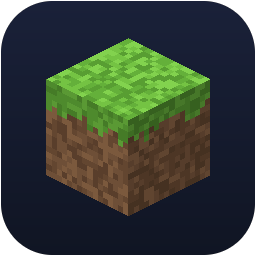
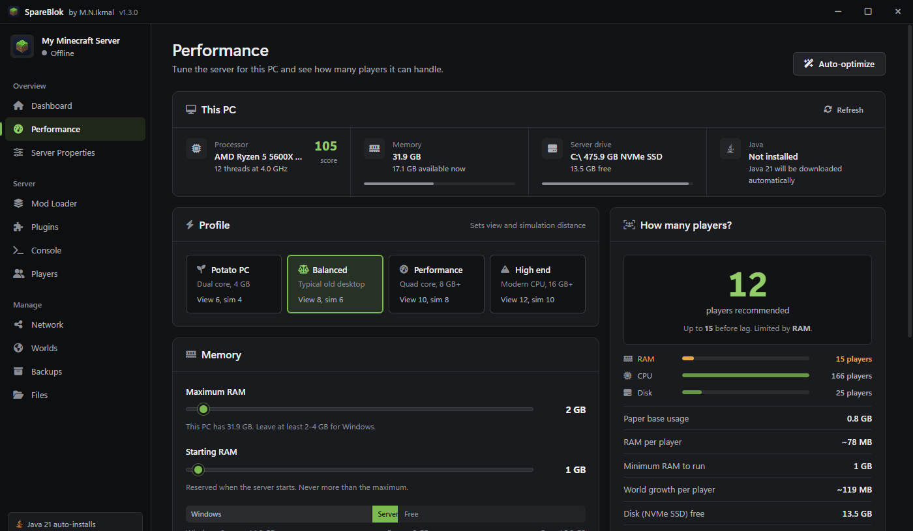
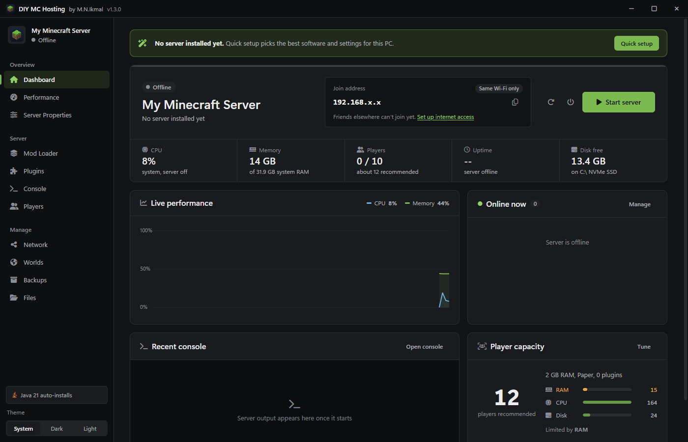
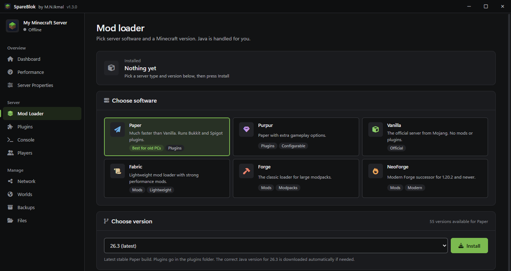

<p align="center">
  
</p>

<h1 align="center">DIY MC Hosting</h1>

<p align="center">
  <strong>Turn an old PC into a Minecraft server, without touching Java or the command line.</strong><br>
  A free, open-source Windows app that installs, tunes, and runs a Minecraft Java server for you.
</p>

<p align="center">
  <a href="https://github.com/Ikmal1270/Minecraft-self-hosting/releases/latest"></a>
</p>

<p align="center">
  
  
  <a href="LICENSE"></a>
  
</p>

<p align="center">
  <a href="#get-started-in-3-steps">Get started</a> ·
  <a href="#why-use-it">Why use it</a> ·
  <a href="#safety-and-privacy">Safety and privacy</a> ·
  <a href="#faq">FAQ</a> ·
  <a href="#build-from-source">Build from source</a>
</p>

<p align="center">
  
</p>

## Get started in 3 steps

1. **Download** the installer or the portable `.exe` from the [latest release](https://github.com/Ikmal1270/Minecraft-self-hosting/releases/latest).
2. **Open it and run Quick setup.** It detects your PC, recommends software and settings, asks you to accept the Minecraft EULA, and installs everything, including the right version of Java.
3. **Start the server and invite friends.** On the **Network** page, one button sets up a public address through playit.gg, with no router setup.

| Download | Best for | Size |
|----------|----------|------|
| `DIY-MC-Hosting-Setup-<version>.exe` | Most people. Adds Start menu and desktop shortcuts, no admin rights needed | about 120 MB |
| `DIY-MC-Hosting-Portable-<version>.exe` | Running without installing | about 110 MB |

> [!NOTE]
> **Windows may show "Windows protected your PC".** The app isn't code-signed yet, and SmartScreen warns about unsigned apps from new publishers. Check the file first ([how to verify it](#verify-your-download)), then choose **More info → Run anyway**.

**You need:** 64-bit Windows 10 or 11. The lightest profile, Potato PC, is aimed at a dual-core CPU with 4 GB of RAM. Nothing else needs to be installed first.

### Or use the one-click installer

No release to download, or you'd rather build it yourself from the code? You don't need any coding knowledge:

1. **[Download the ZIP](https://github.com/Ikmal1270/Minecraft-self-hosting/archive/refs/heads/main.zip)**.
2. **Right-click it and choose Extract All.**
3. **Open the extracted folder and double-click `Install.bat`.** If Windows warns you, choose **More info → Run anyway**.

It builds the app, installs it, and opens it for you, usually within a few minutes depending on your internet speed. It needs about 4 GB of free space while it works. Afterward you can delete the extracted folder, and the app stays installed.

<details>
<summary><strong>What Install.bat does</strong></summary>
<br>

1. Checks your PC, and uses Node.js if you already have version 20 or newer. If not, it downloads a private copy from `nodejs.org` into the extracted folder and checks its SHA-256 hash. Nothing is installed system-wide.
2. Downloads the app's build tools from npm and GitHub.
3. Builds the installer into `dist\`.
4. Runs the installer silently for your Windows user only, with no admin rights, then opens the app. Your existing servers and worlds are kept.

You can read the whole script in [`scripts/install.ps1`](scripts/install.ps1).

</details>

## Why use it

- **It tells you how many players your PC can handle.** You get an estimate from your real hardware, and it shows which limit you'll hit first.
- **It tunes itself.** Auto-Optimize picks RAM, view distance, simulation distance, and JVM flags, and always leaves enough RAM for Windows.
- **Friends can join without port forwarding.** The playit.gg tunnel works even behind CGNAT, which is common on mobile and 5G broadband.
- **Any popular server type, in one click.** Choose Vanilla, Paper, Purpur, Fabric, Forge, or NeoForge. The correct Java is detected or downloaded for you.
- **Mods without the hunting.** Search Modrinth from inside the app, or install a "Recommended for old PCs" pack.

<table>
  <tr>
    <td width="50%"></td>
    <td width="50%"></td>
  </tr>
  <tr>
    <td align="center"><strong>Everything at a glance</strong></td>
    <td align="center"><strong>Pick your server software</strong></td>
  </tr>
</table>

## Features

<details>
<summary><strong>Performance tuning</strong></summary>
<br>

- **Hardware detection:** CPU model, a single-core benchmark score (Minecraft ticks on one thread), RAM, the server drive's free space, and whether that drive is an HDD, SSD, or NVMe.
- **Auto-Optimize for this PC:** sets RAM allocation, view distance, simulation distance, and JVM flags.
- **Performance profiles:** Potato PC / Balanced / Performance / High End.
- **JVM presets:** Low-End (Serial GC), Default (G1), Aikar's Flags, or Custom.
- **Process priority:** Below Normal / Normal / Above Normal / High.
- **Live monitoring:** server CPU and RAM usage, system usage, and an uptime chart.

</details>

<details>
<summary><strong>Player capacity estimates</strong></summary>
<br>

The capacity engine (`src/capacity.js`) estimates players from four limits and shows which one runs out first:

| Limit   | What it models |
|---------|----------------|
| RAM     | Base usage of the server type + per-mod cost + per-player chunks (scales with view distance) |
| CPU     | Single-core score × core count × simulation distance (the biggest CPU cost); HDDs get a penalty |
| Disk    | World growth per player over time, plus your zipped backups, minus 2 GB headroom for Windows |
| Network | Optional: your upload speed vs. chunk streaming per player |

The estimate updates live as you move the sliders. It also gives tips, such as lowering the simulation distance when the CPU is your limit, and has a one-click "set max players to recommended" button. The numbers are conservative community-derived averages, not guarantees.

</details>

<details>
<summary><strong>Server software and mods</strong></summary>
<br>

- **One-click install** of Vanilla, Paper, Purpur, Fabric, Forge, and NeoForge for any supported Minecraft version.
- **Automatic Java:** a portable Temurin JRE is downloaded if needed. Nothing is installed system-wide.
- **Forge and NeoForge** installers run headless, and the app detects the correct launch method (`win_args.txt` or jar).
- **Mods & Plugins manager:**
  - Search and install from Modrinth, filtered to your loader and version, with required dependencies installed automatically.
  - Drag and drop your own `.jar` files.
  - Enable, disable, or delete each mod.
  - One-click "Recommended for old PCs" packs (Lithium, FerriteCore, Krypton, ModernFix, Chunky, spark).

</details>

<details>
<summary><strong>Letting friends join</strong></summary>
<br>

Three options, easiest first:

1. **Internet with playit.gg (recommended).** One button downloads the official signed playit agent, opens playit.gg so you can approve the app, and creates a Minecraft Java tunnel automatically. You get a permanent public address with no router setup.
2. **Same Wi-Fi / LAN.** Works immediately with this PC's local address.
3. **Port forwarding (advanced).** Public IP with CGNAT detection, a Windows Firewall rule, automatic router forwarding via UPnP, and a manual guide.

</details>

<details>
<summary><strong>Day-to-day management</strong></summary>
<br>

- **Console:** colored log, command history (↑/↓), and quick commands.
- **Players:** who's online, op/kick/ban, whitelist, and ban lists.
- **Worlds:** switch, import, regenerate, or delete worlds.
- **Backups:** zipped backups taken safely while the server runs (`save-off` / `save-all flush`), with scheduled auto-backups, retention, and one-click restore.
- **Files:** browse and edit config files in the app.
- **Reliability:** auto-restart on crash (with crash-loop protection), minimize to the system tray while hosting, and a graceful stop on exit.
- **Comfort:** System / Dark / Light themes, full keyboard access, and support for the Windows "reduce animations" setting.

</details>

## Safety and privacy

You're being asked to run an app on your PC, so here's exactly what it does. The full source is in this repository, so you can check all of this yourself.

- **No telemetry.** The code contains no analytics, tracking, ads, or auto-updater.
- **No account needed**, unless you choose the playit.gg tunnel, which uses your own playit.gg account.
- **Admin rights are only requested for one thing:** adding a Windows Firewall rule, if you use port forwarding. Windows shows a UAC prompt, and you can decline it.
- **The playit agent's signature is checked.** If the downloaded agent doesn't pass, it's deleted instead of run.
- **The UI is sandboxed.** Electron's `sandbox` and `contextIsolation` are on, and `nodeIntegration` is off.

<details>
<summary><strong>Every service the app connects to</strong></summary>
<br>

| Service | Why | When |
|---------|-----|------|
| Mojang (`mojang.com`) | Version list and the Vanilla server | Choosing or installing server software |
| PaperMC, PurpurMC, FabricMC, Minecraft Forge, NeoForged | Versions and server software | Choosing or installing that software |
| Eclipse Adoptium (`api.adoptium.net`) | Temurin Java download | When the right Java isn't already on your PC |
| Modrinth (`api.modrinth.com`) | Mod search and downloads | Using the Mods & Plugins manager |
| playit.gg and its GitHub releases | Agent download and tunnel | Only if you set up the playit.gg tunnel |
| ipify, icanhazip | Showing your public IP address | Looking up your public address |
| mc-heads.net | Head icons, which sends online players' names | Players are online |

</details>

### What's added to your server

Every player who joins gets this private chat message, which can't currently be turned off:

> *Thanks for using DIY MC Hosting and just a reminder this system version \<version\> is still under early development ~ M.N.Ikmal*

The same text is the default server-list MOTD, and you can change that one in the settings.

### Verify your download

Compare your file's hash with the SHA-256 listed in the [release notes](https://github.com/Ikmal1270/Minecraft-self-hosting/releases/latest). Run this in PowerShell, using the name of the file you downloaded:

```powershell
Get-FileHash .\DIY-MC-Hosting-Setup-1.3.0.exe -Algorithm SHA256
```

If the hashes don't match, don't run the file. You can also scan it on [VirusTotal](https://www.virustotal.com/) or [build it yourself](#build-from-source).

## FAQ

**Is it free?**
Yes. The app is free and open source under the [MIT license](LICENSE). playit.gg is a separate service with its own plans and terms.

**Does my PC have to stay on?**
Yes. The server runs on your PC, so players can only join while it's on and the server is running. You can minimize the app to the system tray while hosting.

**Do my friends need to install anything?**
No. They only need Minecraft: Java Edition and your server's address. If you've installed mods, they may need matching mods too.

**Does it support Bedrock Edition?**
No. It runs Minecraft Java Edition servers.

**Is it stable?**
It's in early development, so expect rough edges and keep backups turned on. If something breaks, please [open an issue](https://github.com/Ikmal1270/Minecraft-self-hosting/issues).

**Where is my data, and how do I remove it?**
Everything is in `%APPDATA%\mchost\`. The folder keeps the app's original name (MCHost) so upgrades never lose your servers. Uninstalling leaves it in place, so delete it yourself if you want your worlds and backups gone.

| Path | Contents |
|------|----------|
| `server-config.json` | Settings |
| `servers\default\` | Server files (change this in Mod Loader → Server folder) |
| `backups\` | Zipped backups |
| `runtimes\` | Java runtimes and the playit agent |
| `playit\` | The playit secret key and agent log |

## Build from source

This section is for developers. If you just want to use the app, see the [one-click installer](#or-use-the-one-click-installer).

You'll need [Node.js](https://nodejs.org/) and Windows.

```bash
npm install
npm start
```

To build the `.exe` files into `dist/`:

```bash
npm run build            # installer and portable .exe
npm run build:installer  # installer .exe only
npm run build:portable   # portable .exe only
npm run build:dir        # unpacked folder, fastest for testing
```

To regenerate the icon, run `npm run icon` (it writes `assets/icon.png` and `assets/icon.ico`).

<details>
<summary><strong>Project layout</strong></summary>

```
Install.bat        One-click build and install for non-developers
main.js            Electron main process: window, tray, IPC wiring
preload.js         Safe bridge exposing window.mchost to the UI
src/
  brand.js         Product name, author, join message
  capacity.js      Player capacity estimation + auto-tuning
  config.js        Settings storage and data folders
  loaders.js       Server software catalogue, versions, installers
  java.js          Java detection + automatic download
  server.js        Server process, log parsing, monitoring, auto-restart
  properties.js    server.properties read/merge/write
  mods.js          Mods/plugins folder + Modrinth integration
  backups.js       Zip backups, restore, world management
  system.js        Hardware info, disk type, CPU benchmark, firewall
  upnp.js          Router port forwarding (UPnP IGD)
  playit.js        playit.gg tunnel: agent download, account linking, tunnel creation
  net.js, util.js  HTTP and process helpers
renderer/          UI (HTML/CSS/JS) + bundled Font Awesome
scripts/           Install script and icon generator
assets/            App icon
docs/screenshots/  Images used in this README
```

</details>

## License

[MIT](LICENSE) © 2026 M.N.Ikmal

*DIY MC Hosting is not an official Minecraft product and is not approved by or associated with Mojang or Microsoft.*
